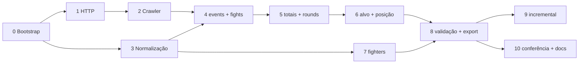

# Plano de execução — Scraper UFC Stats

Data: 2026-09-21 · Spec de referência: [spec.md](spec.md)

Este plano divide a implementação em **partes disjuntas e sequenciais**. Cada parte
tem pré-requisitos, entregáveis (arquivos) e um critério de conclusão verificável
por comando. A ideia é que qualquer pessoa (ou sessão de IA) consiga abrir este
arquivo, ver onde parou e continuar sem precisar reconstruir contexto.

---

## 0. Como usar este plano (protocolo de retomada)

1. Leia a tabela **Status** abaixo e localize a primeira parte não concluída.
2. Leia a seção dessa parte inteira antes de escrever código. Leia também a
   seção **Convenções**.
3. Rode `git log --oneline` e `uv run pytest -q` para confirmar que o estado do
   repositório bate com o Status (se os testes de partes anteriores falham,
   conserte antes de avançar).
4. Ao concluir uma parte:
   - marque as caixas de tarefa `[x]` na seção da parte;
   - rode o **Critério de conclusão** e cole a saída resumida em *Notas de execução*;
   - faça **um commit** com mensagem `parte N: <título>`;
   - atualize a tabela Status (estado + hash do commit). Como o hash só existe
     depois do commit, registre-o num commit `docs: registra hash da parte N`
     logo em seguida (ou junto do próximo commit de trabalho).
5. Se precisar interromper no meio de uma parte, escreva em *Notas de execução*
   da parte **o que já está feito, o que falta e qualquer decisão tomada**. Não
   deixe código sem teste passando no commit; se necessário, commit com prefixo
   `wip(parte N):`.

Regra de ouro: **uma parte só está concluída quando o critério de conclusão passa.**

### Status

| Parte | Título | Estado | Commit |
| --- | --- | --- | --- |
| 0 | Bootstrap do projeto | ✅ concluída | `ed91d72` |
| 1 | Cliente HTTP com cache, rate limit e retry | ✅ concluída | `0424a96` |
| 2 | Crawler completo (coleta do HTML bruto) | ✅ concluída (coleta completa em andamento) | `b03a018` |
| 3 | Funções de normalização | ✅ concluída | `a8ae2d9` |
| 4 | Parser de eventos e resumo das lutas | ✅ concluída (reconferir com eventos antigos) | `af71019` |
| 5 | Parser de estatísticas totais e por round | ⬜ pendente | — |
| 6 | Parser de golpes significativos por alvo e posição | ⬜ pendente | — |
| 7 | Parser de lutadores | ⬜ pendente | — |
| 8 | Validação, relatório de cobertura e exportação | ⬜ pendente | — |
| 9 | Modo incremental | ⬜ pendente | — |
| 10 | Conferência manual e documentação final | ⬜ pendente | — |

Estados: `⬜ pendente` · `🟨 em andamento` · `✅ concluída`

---

## Convenções (valem para todas as partes)

**Stack:** Python 3.12, gerenciado com `uv`. Dependências: `requests`,
`beautifulsoup4`, `lxml`, `pandas`, `pyarrow`. Dev: `pytest`. CLI com `argparse`
(sem dependência extra). Sem Scrapy.

**Layout do repositório** (criado na Parte 0; partes seguintes só preenchem):

```
ufc-stats-scraper/
├── pyproject.toml
├── .gitignore                 # data/, .venv/, __pycache__/, *.log
├── README.md
├── .specify/
│   ├── spec.md
│   └── plan.md                # este arquivo
├── src/ufc_scraper/
│   ├── __init__.py
│   ├── __main__.py            # CLI: crawl | parse | validate | export
│   ├── config.py              # Settings: delay, pasta de saída, UA, data, modo
│   ├── logging_setup.py
│   ├── paths.py               # URL <-> caminho no cache; ID <-> URL
│   ├── http.py                # fetch() com cache, rate limit, retry   (P1)
│   ├── links.py               # extração de IDs/links das páginas       (P2)
│   ├── crawl.py               # orquestração da coleta                  (P2, P9)
│   ├── normalize.py           # funções puras de conversão              (P3)
│   ├── parse/
│   │   ├── __init__.py
│   │   ├── events.py          # events + fights (a partir do evento)   (P4)
│   │   ├── fights.py          # resumo da luta (fight-details)          (P4)
│   │   ├── fight_stats.py     # fight_stats + round_stats               (P5, P6)
│   │   └── fighters.py        # fighters                                (P7)
│   ├── validate.py                                                      (P8)
│   └── export.py                                                        (P8)
├── tests/
│   ├── fixtures/              # HTML real e pequeno, versionado no git
│   └── test_*.py
└── data/                      # ignorado pelo git
    ├── raw/<YYYY-MM-DD>/      # HTML bruto (layout da spec §3)
    └── processed/<YYYY-MM-DD>/  # CSV/Parquet + relatórios
```

**Regras de código**

- Tipagem simples com `dataclasses`/dicts; sem ORM. Parsers retornam `list[dict]`
  com as colunas exatamente como na spec §4 (`snake_case`, inglês).
- **Parser nunca acessa a rede.** Só lê arquivos em `data/raw/<date>/`.
- **Testes nunca acessam a rede.** Usam `tests/fixtures/*.html` e `monkeypatch`.
- **Nulo ≠ zero.** `"--"`, vazio e campo ausente viram `None`. Nunca `0`.
- Valores não mapeados (método, categoria) vão para o log com `WARNING` e ficam
  no campo `*_raw`; nunca são descartados silenciosamente.
- Toda tabela carrega `scraped_at` (= nome da pasta de coleta, `YYYY-MM-DD`) e
  `source_url`.
- Log em arquivo `data/processed/<date>/scraper.log` **e** no console.

**Comandos de referência**

```bash
uv sync                                  # instala deps
uv run pytest -q                         # testes
uv run python -m ufc_scraper --help      # CLI
uv run python -m ufc_scraper crawl   --date 2026-09-21 [--limit 3]
uv run python -m ufc_scraper parse   --date 2026-09-21 [--table events]
uv run python -m ufc_scraper validate --date 2026-09-21
uv run python -m ufc_scraper export  --date 2026-09-21 --format parquet
```

**Sobre a pasta de coleta (`--date`)**: o padrão é a data de hoje, mas uma coleta
interrompida deve ser retomada **passando a mesma data** da pasta original;
caso contrário o crawler começa uma pasta nova e baixa tudo de novo.

**Fixtures de teste**: HTML real copiado de `data/raw/` para `tests/fixtures/`
na Parte 2. Manter pequeno (poucas páginas, escolhidas para cobrir casos-limite).
Nomear como `<tipo>_<descricao>_<id>.html`, ex.: `event_old_no_stats_<id>.html`.

**Dicas de seletores** (a confirmar contra o HTML real — o site pode ter mudado):
as classes CSS do UFC Stats seguem o prefixo `b-`; ex.: `b-statistics__table`,
`b-fight-details__table`, `b-fight-details__person`, `b-list__box-list-item`,
`b-fight-details__text-item`. Em tabelas, `tr` costuma trazer `data-link` com a URL
da entidade. Sempre inspecione a fixture antes de codar o seletor.

**robots.txt**: verificado em 2026-09-21 — o site retorna 404 (não existe). Valem
as regras da spec §6: 1 requisição por vez, 1–2 s de intervalo, User-Agent
identificável com contato do grupo.

---

## Parte 0 — Bootstrap do projeto

**Objetivo:** repositório executável, com CLI vazia, configuração, logging e
testes rodando. Nenhuma lógica de scraping ainda.

**Pré-requisitos:** nenhum (estado atual: só `README.md` e `.specify/spec.md`).

**Tarefas**

- [x] Criar `pyproject.toml` com `uv` (nome `ufc-scraper`, `requires-python >= 3.12`,
      deps e dev-deps listadas em Convenções; `[tool.pytest.ini_options] testpaths = ["tests"]`;
      configurar `src` layout).
- [x] Criar `.gitignore` (`data/`, `.venv/`, `__pycache__/`, `*.pyc`, `*.log`, `.pytest_cache/`).
- [x] Criar a árvore `src/ufc_scraper/` e `tests/` com `__init__.py` onde couber.
- [x] `config.py`: `@dataclass Settings` com `base_url` (`http://ufcstats.com`),
      `data_dir` (`data`), `date` (str `YYYY-MM-DD`, padrão hoje), `delay_min=1.0`,
      `delay_max=2.0`, `timeout=30`, `max_retries=3`, `backoff=(5, 15, 45)`,
      `user_agent` (com e-mail de contato do grupo), `mode` (`full|incremental`).
      Função `settings_from_args(argparse.Namespace) -> Settings`.
- [x] `paths.py`: funções puras `raw_dir(settings)`, `processed_dir(settings)`,
      `cache_path(settings, kind, key)` implementando o layout da spec §3
      (`events_list.html`, `events/<id>.html`, `fights/<id>.html`,
      `fighters/<id>.html`, `fighters_list/<letra>.html`) e
      `url_for(kind, key)` (ex.: `("event", id) -> /event-details/<id>`;
      `("events_list", None)`; `("fighters_list", "a")`).
- [x] `logging_setup.py`: `setup_logging(settings)` — console + arquivo em
      `processed_dir/scraper.log`, formato com timestamp.
- [x] `__main__.py`: `argparse` com subcomandos `crawl`, `parse`, `validate`,
      `export`, cada um ainda apenas imprimindo "não implementado" e saindo com
      código 2. Flags globais: `--date`, `--data-dir`. Flags de `crawl`:
      `--limit`, `--mode`, `--delay-min`, `--delay-max`. Flags de `parse`: `--table`.
      Flags de `export`: `--format {csv,parquet,sqlite}`.
- [x] `tests/test_paths.py`: testa `cache_path` e `url_for` para cada tipo.
- [x] Atualizar `README.md` com: objetivo em 3 linhas, como instalar (`uv sync`),
      comandos de referência e link para `.specify/spec.md` e `.specify/plan.md`.

**Entregáveis:** `pyproject.toml`, `.gitignore`, `uv.lock`, `src/ufc_scraper/{__init__,__main__,config,paths,logging_setup}.py`, `tests/test_paths.py`, `README.md`.

**Critério de conclusão**

```bash
uv sync && uv run pytest -q                       # todos passam
uv run python -m ufc_scraper --help               # lista os 4 subcomandos
uv run python -m ufc_scraper crawl --date 2026-09-21; echo "exit=$?"   # exit=2
```

**Notas de execução**

- Concluída em 2026-09-21. `uv sync` + 24 testes passando (`tests/test_paths.py`, `tests/test_config.py`).
- Build backend: `hatchling` com `packages = ["src/ufc_scraper"]`; dev-deps em `[dependency-groups]` (formato do uv).
- `Settings.__post_init__` valida `date` (ISO), `mode` e `delay_min <= delay_max`; a CLI sai com exit 1 em erro de configuração e exit 2 em comando não implementado.
- `setup_logging` é idempotente (não duplica handlers) e abre o log em append para retomadas.
- `__main__.run()` é o ponto de despacho: cada parte seguinte substitui o stub do seu subcomando lá.

---

## Parte 1 — Cliente HTTP com cache, rate limit e retry

**Objetivo:** uma única função `fetch(settings, kind, key) -> str` que devolve o
HTML, lendo do cache em disco quando existe e baixando (com todas as regras
da spec §6) quando não existe. Todo o resto do crawler depende só dela.

**Pré-requisitos:** Parte 0 concluída.

**Tarefas**

- [x] `http.py`:
  - `fetch(settings, kind, key, *, force=False) -> str`:
    1. calcula `path = cache_path(...)`; se existe e `not force`, lê e retorna
       (log `DEBUG cache hit`); **sem sleep em cache hit**;
    2. senão, aplica rate limit: dorme `random.uniform(delay_min, delay_max)`
       desde a **última requisição real** (guardar timestamp em módulo/objeto);
    3. `requests.get(url, headers={"User-Agent": ...}, timeout=30)`;
    4. em `5xx`, `ConnectionError`, `Timeout`: retry até `max_retries` com
       esperas `backoff` (5 s, 15 s, 45 s); após esgotar, levanta `FetchError`;
    5. em `404`: **não** faz retry; levanta `NotFound` (o chamador decide);
    6. em `200`: grava atomicamente (escreve em `path.tmp` e renomeia) e retorna;
    7. log `INFO` com URL, status e tempo de resposta em ms para cada requisição real.
  - Classe única `Session` (ou estado de módulo) para reaproveitar
    `requests.Session` e guardar o timestamp do rate limit.
- [x] `tests/test_http.py` com `monkeypatch`/`unittest.mock` (sem rede):
  - cache hit não chama `requests` nem `sleep`;
  - cache miss chama uma vez, grava o arquivo, segunda chamada é hit;
  - `500, 500, 200` → 3 tentativas, sucesso, `sleep` chamado com 5 e 15;
  - `500 × 4` → `FetchError`;
  - `404` → `NotFound` sem retry;
  - rate limit: duas chamadas reais em sequência chamam `sleep` com valor no
    intervalo `[delay_min, delay_max]`.
- [x] Smoke test manual (única vez que esta parte toca a rede): baixar a lista de
      eventos e confirmar cache.

**Entregáveis:** `src/ufc_scraper/http.py`, `tests/test_http.py`.

**Critério de conclusão**

```bash
uv run pytest -q tests/test_http.py
uv run python -c "
from ufc_scraper.config import Settings
from ufc_scraper.http import fetch
s = Settings(date='2026-09-21')
html = fetch(s, 'events_list', None); print(len(html))
html = fetch(s, 'events_list', None); print('segunda chamada veio do cache')"
ls data/raw/2026-09-21/events_list.html
```

**Notas de execução**

- 2026-09-21 — `http.py` e `tests/test_http.py` prontos (40 testes no total). `Fetcher` recebe
  `session`, `sleep`, `clock` e `rng` injetáveis; `fetch()` de módulo reaproveita um `Fetcher`
  por `Settings`. Retry: 1 + `max_retries` tentativas, backoff `(5, 15, 45)`; rate limit só
  antes da 1ª tentativa de cada `fetch` (entre retries o backoff já é maior). Arquivo gravado
  como bytes crus; leitura em UTF-8. `NotFound` e `FetchError` são irmãs (não subclasses).
- **BLOQUEIO no smoke test.** O site devolve HTTP 200 com uma interstitial
  `<title>Loading…</title> / "Checking your browser…"` de ~3 KB contendo um desafio
  proof-of-work em JavaScript: calcula `sha256(nonce + ':' + n)` incrementando `n` até o hash
  começar com `00`, faz `POST /__c` com `nonce` e `n`, e recarrega a página (presumivelmente
  o POST define um cookie de sessão). A premissa da spec §2 ("sem JavaScript necessário")
  está desatualizada. Ação tomada: `is_challenge_page()` detecta a interstitial, o `Fetcher`
  levanta `ChallengeRequired` e **nunca grava** essa página no cache. Decisão sobre como
  prosseguir (resolver o desafio no cliente, com os mesmos limites de taxa, ou outra rota)
  fica com o grupo — ver conversa/commit. Só 1 GET real foi feito ao site nesta parte.
- **Decisão (2026-09-21): resolver o desafio no cliente.** `parse_challenge` extrai `nonce` e
  dificuldade do script; `solve_challenge` acha o menor `n`; `Fetcher._pass_challenge` faz
  `POST /__c` na mesma `requests.Session` (cookie `_fmc` fica nela) e `_get` repete o GET uma
  única vez. Tudo respeita o rate limit. Se a interstitial persistir ou o POST falhar,
  `ChallengeRequired` (não retryable). Guarda-rails: dificuldade aceita 1–6; script fora do
  padrão levanta `ValueError` (o site mudou de novo). 44 testes no total.
- Smoke test OK: GET → interstitial → POST /__c 204 (`n=20`) → GET 200 com 629 KB e 790 links
  `/event-details/`; segunda chamada veio do cache. 3 requisições reais ao site nesta rodada.
- Spec §2 e §6 atualizadas com a premissa corrigida e o resultado do `robots.txt`.

---

## Parte 2 — Crawler completo (coleta do HTML bruto)

**Objetivo:** comando `crawl` que percorre lista de eventos → eventos → lutas →
lutadores (pelas duas rotas: links das lutas **e** lista A–Z), salvando tudo no
cache. Retomável (se interrompido, roda de novo e continua). Ao final desta parte
a **coleta completa é disparada em background** e roda enquanto as partes 3–8
são desenvolvidas contra uma amostra.

**Pré-requisitos:** Parte 1 concluída.

**Tarefas**

- [x] `links.py` — extração **mínima** de links (só hrefs com ID; não é o parser):
  - `event_ids(events_list_html) -> list[str]` (ordem da página, mais recente primeiro);
  - `fight_ids(event_html) -> list[str]`;
  - `fighter_ids(html) -> list[str]` (serve para página de evento, luta e lista A–Z);
  - `extract_id(url) -> str` (último segmento hexadecimal da URL).
  - Deduplicar mantendo ordem.
- [x] `crawl.py` — `run_crawl(settings, limit: int | None)`:
  1. `events_list` (`?page=all`);
  2. para cada `event_id` (respeitando `--limit`): `fetch` evento;
  3. para cada luta do evento: `fetch` luta; coletar `fighter_ids` do evento e da luta;
  4. para cada letra `a..z`: `fetch` lista de lutadores; coletar `fighter_ids`;
  5. para cada `fighter_id` único (união dos passos 3 e 4): `fetch` lutador;
  6. tratar `NotFound` com `WARNING` e seguir; tratar `FetchError` com `ERROR`,
     registrar o ID em `processed_dir/crawl_failures.txt` e seguir;
  7. ao final, log de contagens: eventos, lutas, lutadores baixados / em cache / falhas.
  - Com `--limit N`, limitar apenas os eventos (as lutas e lutadores desses eventos
    são baixados normalmente; a lista A–Z é **pulada** quando há `--limit`, para a
    amostra ficar pequena).
- [x] Ligar `crawl` no `__main__.py`.
- [x] `tests/test_links.py`: usa fixtures pequenas (criar nesta parte, ver abaixo).
- [x] `tests/test_crawl.py`: `monkeypatch` em `fetch` devolvendo fixtures; verifica a
      ordem de chamadas e a deduplicação de lutadores.
- [x] Rodar `crawl --date 2026-09-21 --limit 3` e, a partir de `data/raw/`, copiar
      para `tests/fixtures/`:
  - `events_list.html` (pode ser grande; se > 1 MB, cortar para as ~50 primeiras linhas
    de tabela mantendo o HTML válido);
  - 1 evento moderno (`event_modern_<id>.html`) com todas as suas páginas de luta;
  - 1 página de luta com decisão (placares dos juízes), 1 com KO/TKO, 1 com SUB;
  - `fighters_list_x.html` (letra com poucos lutadores);
  - 2–3 páginas de lutador (um com campos `--`).
  - **Fixtures antigas** (evento sem estatísticas, empate, no contest, luta de título,
    luta feminina) serão adicionadas na Parte 4 quando a coleta completa já tiver
    esses arquivos; anotar aqui como pendência.
- [x] Disparar a coleta completa em background e registrar o comando usado em
      *Notas de execução*:
  ```bash
  nohup uv run python -m ufc_scraper crawl --date 2026-09-21 > data/crawl_full.out 2>&1 &
  ```
  Estimativa: ~13 mil páginas × ~1,5 s ≈ 5–6 h. Se cair, rodar o mesmo comando de
  novo (mesma `--date`) — o cache retoma.

**Entregáveis:** `src/ufc_scraper/{links,crawl}.py`, `tests/{test_links,test_crawl}.py`,
`tests/fixtures/*.html` (amostra), coleta completa em andamento ou concluída.

**Critério de conclusão**

```bash
uv run pytest -q
uv run python -m ufc_scraper crawl --date 2026-09-21 --limit 3     # termina sem ERROR
find data/raw/2026-09-21 -name '*.html' | wc -l                     # > 30
uv run python -m ufc_scraper crawl --date 2026-09-21 --limit 3     # 2ª vez: só cache hits, termina em segundos
```

**Notas de execução**

- 2026-09-21 — `links.py` (regex sobre o HTML: apanha `href` com e sem aspas e `data-link`) e
  `crawl.py` (`Crawler` com `CrawlReport`; `run_crawl(settings, limit, fetcher)` — `fetcher`
  injetável para testes). 57 testes no total.
- **Achado:** a lista "completed" traz como primeira linha o **próximo evento futuro**
  (`tr.b-statistics__table-row_type_first` com ícone `next.png`). `event_ids` pula essa linha
  (eventos futuros estão fora do escopo). Lista real: 790 links → 789 eventos realizados.
- IDs têm sempre 16 hex. Na lista A–Z cada lutador aparece 3× (nome, sobrenome, apelido);
  a deduplicação resolve. Na página de luta o método vem por extenso (`Decision - Unanimous`,
  `KO/TKO`, `Submission`) — no card do evento vem abreviado (`U-DEC`…). Anotar para a Parte 4.
- `ChallengeRequired` aborta a coleta (exit 3); `NotFound`/`FetchError` só registram em
  `crawl_failures.txt` e seguem; exit 1 se houve falhas.
- `crawl --limit 3`: 3 eventos, 39 lutas, 78 lutadores, 121 requisições em 4 min (~2 s/página),
  0 falhas; segunda rodada 0,3 s só com cache hits.
- Fixtures (400 KB): `events_list.html` cortada para 30 linhas (mantém a linha do evento futuro),
  `event_modern_8a0a35e7c74bebcc` (UFC 331, 12 lutas), `fight_udec_title_5r_568ec6af4008355a`
  (título, 5 rounds, cinturão + bônus Fight), `fight_sdec_1aa008d8597a73b8`,
  `fight_ko_bonus_fe612d20eec7ef35` (Performance), `fight_sub_034c04e480d87b8f` (detalhe em
  2 linhas: "Rear Naked Choke / One-arm RNC"), `fighters_list_x.html` (4 lutadores),
  `fighter_17e97649403ba428` (Van), `fighter_a0f0004aadf10b71` (Pantoja).
- **Pendência para a Parte 4:** nenhum lutador recente tem campo `--`; pegar um antigo da
  coleta completa. Idem fixtures antigas (evento sem stats, empate, NC, feminina, overturned).
- **Coleta completa disparada em 2026-09-21 15:50** (PID 99510):
  `nohup uv run python -m ufc_scraper crawl --date 2026-09-21 > data/crawl_full.out 2>&1 &`
  Acompanhar com `tail -f data/crawl_full.out` ou `grep -c ' GET ' data/crawl_full.out`.
  Estimativa: ~13 mil páginas × ~2,3 s ≈ 8 h. Se cair, rodar o mesmo comando (o cache retoma).
  _(preencher ao terminar: linha "coleta encerrada" do log e `find data/raw/2026-09-21 -name '*.html' | wc -l`)_

---

## Parte 3 — Funções de normalização

**Objetivo:** implementar todas as conversões da spec §5 como funções puras,
com testes exaustivos. Nenhum parser ainda; esta parte não depende de HTML.

**Pré-requisitos:** Parte 0 concluída (pode ser feita em paralelo à coleta da
Parte 2 sem conflito, mas a ordem sequencial oficial é após a Parte 2).

**Tarefas** — todas em `normalize.py`, todas retornando `None` para `"--"`, `""`, `None`:

- [x] `clean_text(s) -> str | None` — colapsa espaços/quebras, `strip`, mantém acentos.
- [x] `parse_of(s) -> tuple[int | None, int | None]` — `"45 of 102" -> (45, 102)`.
- [x] `parse_int(s) -> int | None`.
- [x] `parse_mmss(s) -> int | None` — `"3:24" -> 204`; `"--" -> None`; tolerar `"15:00"`.
- [x] `parse_height(s) -> float | None` — `"5' 11\"" -> 180.3` (1 casa decimal).
- [x] `parse_reach(s) -> float | None` — `"72\"" -> 182.9`.
- [x] `parse_weight(s) -> float | None` — `"155 lbs." -> 70.3`.
- [x] `parse_date(s) -> str | None` — `"Mar. 15, 2025" -> "2025-03-15"`; também
      `"March 15, 2025"` e `"Mar 15, 2025"` (sem ponto).
- [x] `parse_time_format(s) -> int | None` — `"5 Rnd (5-5-5-5-5)" -> 5`;
      `"3 Rnd (5-5-5)" -> 3`; `"1 Rnd + OT (12-3)" -> 1`; `"No Time Limit" -> None`.
- [x] ~~`parse_percent` não existe~~ **Corrigido:** `parse_percent("43%") -> 0.43` existe, mas é
      **só para as estatísticas de carreira do perfil** (não há landed/attempted para recalcular).
      Nas tabelas de luta os percentuais continuam descartados (spec §5).
- [x] `normalize_method(s) -> tuple[str, str | None]` — retorna `(method, method_detail)`
      a partir das duas linhas da coluna Method. Conjunto fixo:
      `KO/TKO, SUB, U-DEC, S-DEC, M-DEC, DQ, OVERTURNED, CNC, OTHER`. Valor fora do
      conjunto: log `WARNING` e retorna `("OTHER", s)`. Manter dicionário `METHOD_MAP`
      exportado.
- [x] `went_to_decision(method) -> bool` — `True` para `U-DEC, S-DEC, M-DEC`.
- [x] `normalize_weight_class(s) -> tuple[str, bool, bool]` — retorna
      `(weight_class, is_title_fight, is_women)`. Remove `"UFC "`, `" Title Bout"`,
      `" Bout"`, `"Women's "`; conjunto fixo: `Strawweight, Flyweight, Bantamweight,
      Featherweight, Lightweight, Welterweight, Middleweight, Light Heavyweight,
      Heavyweight, Super Heavyweight, Catch Weight, Open Weight`. Fora do conjunto:
      log `WARNING`, retorna o texto limpo. Manter `WEIGHT_CLASS_MAP` exportado.
- [x] `parse_judges(details) -> list[dict] | None` — `"Sal D'Amato 29 - 28. Derek Cleary 29 - 28."`
      → `[{"judge": "Sal D'Amato", "score_a": 29, "score_b": 28}, ...]`. Se o padrão
      não bater, `None` (o texto original fica em `details_raw`).
- [x] `total_fight_seconds(end_round, end_time_seconds, time_format_raw) -> int | None` —
      soma dos rounds anteriores (a partir da duração de cada round no formato,
      ex.: `(5-5-5)`) + `end_time_seconds`. Se o formato for desconhecido, assume
      5 min por round e loga `WARNING` uma vez.
- [x] `tests/test_normalize.py` — um caso por linha da tabela da spec §5 mais os
      casos-limite listados acima (`"--"`, vazio, `None`, espaços extras).

**Entregáveis:** `src/ufc_scraper/normalize.py`, `tests/test_normalize.py`.

**Critério de conclusão**

```bash
uv run pytest -q tests/test_normalize.py     # ≥ 40 casos, todos passam
```

**Notas de execução**

- 2026-09-21 — `normalize.py` com 106 testes (163 no total). Antes de codar, levantei os valores
  reais em ~40 eventos / 377 lutas / 78 lutadores já baixados; depois apliquei todas as funções
  sobre esses ~30 mil valores: **0 `ValueError`, 0 categorias/métodos não mapeados.**
- Extras além do plano: `parse_float`, `parse_percent` (perfil), `round_durations(fmt)`
  (`"3 Rnd (10-5-5)" -> [10, 5, 5]`, usado por `total_fight_seconds`) e `parse_record`
  (`"Record: 9-4-0 (1 NC)" -> (9, 4, 0, 1)`).
- `METHOD_MAP` cobre as **duas formas** do site: abreviada no card (`U-DEC`, `S-DEC`, `M-DEC`,
  `KO/TKO`, `SUB`, `CNC`, `DQ`, `Overturned`) e por extenso na página da luta
  (`Decision - Unanimous`, `Submission`, `Could Not Continue`).
- `normalize_weight_class` remove `UFC `, `Interim `, `Undisputed `, ` Title Bout`, ` Bout`,
  `Women's `; `is_title_fight` = contém "title" (inclui interinos).
- Datas reais: `Sep 27, 2000`, `August 01, 2026`, `Mar. 15, 2025` — todas cobertas. Stance pode
  vir vazio (`None`).
- **Para a Parte 4:** em lutas *overturned* o `Details:` tem uma linha de motivo
  (`Failed Drug Test by Idiris`) **antes** das notas dos juízes (luta `7ffdaa44fc8d111b`).
  O parser deve passar as linhas de `Details:` **separadamente** a `parse_judges` (juntar com
  espaço gruda o motivo no 1º nome). `parse_judges` rejeita nomes com > 4 palavras como
  salvaguarda. Também: na página da luta o `W/L` do card vem como `win` / `draw draw` / `nc nc`
  (o texto repete porque há um `<i>` por lutador).

---

## Parte 4 — Parser de eventos e resumo das lutas

**Objetivo:** gerar as tabelas `events` e `fights` (spec §4) a partir do HTML
salvo. Comando `parse --table events` e `parse --table fights` funcionando e
escrevendo CSV em `data/processed/<date>/`.

**Pré-requisitos:** Partes 2 e 3 concluídas. Coleta completa concluída (ou pelo
menos com eventos antigos já baixados) para as fixtures adicionais.

**Tarefas**

- [~] Adicionar fixtures pendentes da Parte 2 (**parcial**: empate, NC, overturned, feminina e título já
      estão; evento antigo sem estatísticas e lutador com `--` ficam para quando a coleta chegar lá): evento antigo sem estatísticas
      (ex.: UFC 1–10, 1993–96), luta com **empate**, luta com **no contest**, luta de
      **título**, luta **feminina**, luta com **overturned**/DQ se existir. Escolher
      IDs consultando `data/raw/` (grep por `Draw`, `NC`, `belt`, `Women`).
- [x] `parse/events.py`:
  - `parse_events_list(html, settings) -> list[dict]` → linhas de `events`
    (`event_id, name, date, location, scraped_at, source_url`).
  - `parse_event_card(html, event_id, settings) -> list[dict]` → linhas
    **parciais** de `fights` obtidas do card: `fight_id, event_id, fighter_a_id,
    fighter_b_id, winner_id, result_type, weight_class, is_title_fight, is_women,
    bonuses, method, method_detail, end_round, end_time_seconds`. Regras:
    - A = primeiro lutador da linha (canto vermelho), B = segundo. **Não sortear.**
    - `result_type`: `win` se há vencedor, `draw`, `no_contest`; `winner_id` nulo
      nos dois últimos.
    - `bonuses`: lista de strings a partir dos ícones da linha (ex.: `perf`, `fight`,
      `sub`, `ko`, `belt` → belt vira `is_title_fight`, não bônus). Serializar
      como JSON string no CSV.
- [x] `parse/fights.py`:
  - `parse_fight_summary(html, fight_id, settings) -> dict` → campos que só existem
    na página da luta: `time_format_raw, scheduled_rounds, total_fight_seconds,
    referee, details_raw, judges_scores` (JSON string ou nulo), `went_to_decision`.
    Também recolhe `fighter_a_id/fighter_b_id/winner_id/method` como **checagem**:
    se divergir do card, log `WARNING` com o `fight_id` (o card manda).
- [x] `parse/__init__.py`: `build_events(settings) -> DataFrame` e
      `build_fights(settings) -> DataFrame` que percorrem `data/raw/<date>/`,
      juntam card + resumo por `fight_id` e escrevem
      `processed/<date>/events.csv` e `fights.csv`. Lutas cujo HTML de luta está
      ausente (falha de coleta) entram com os campos da página de luta nulos e um
      `WARNING`.
- [x] Ligar `parse --table events|fights` no `__main__.py` (sem `--table`, roda todas
      as tabelas já implementadas).
- [x] `tests/test_parse_events.py` e `tests/test_parse_fights.py` cobrindo cada
      fixture: contagem de lutas por evento, IDs, vencedor, empate, NC, título,
      feminina, placares dos juízes, evento antigo (campos nulos, não zero).

**Entregáveis:** `src/ufc_scraper/parse/{__init__,events,fights}.py`, testes,
fixtures novas, `data/processed/<date>/{events,fights}.csv`.

**Critério de conclusão**

```bash
uv run pytest -q
uv run python -m ufc_scraper parse --date 2026-09-21 --table events
uv run python -m ufc_scraper parse --date 2026-09-21 --table fights
uv run python -c "
import pandas as pd
e = pd.read_csv('data/processed/2026-09-21/events.csv'); f = pd.read_csv('data/processed/2026-09-21/fights.csv')
print(len(e), 'eventos', len(f), 'lutas')
assert e.event_id.is_unique and f.fight_id.is_unique
assert f.event_id.isin(e.event_id).all()
print(f.method.value_counts(dropna=False))"
```

Esperado (coleta completa): ~700 eventos, ~8 000 lutas, nenhum `WARNING` de
método/categoria não mapeados que não esteja justificado nas notas.

**Notas de execução**

- 2026-09-21 — `parse/events.py`, `parse/fights.py`, `parse/__init__.py` (builders + `BUILDERS`),
  CLI `parse` ligada. 193 testes. Rodado sobre a coleta parcial (~70 eventos): 789 eventos,
  849 lutas, 0 divergências card/página, 0 métodos/categorias não mapeados.
- **DECISÃO 1 — ordem A/B vem da página da luta, não do card.** No card o vencedor é SEMPRE
  listado primeiro (673/673), então a ordem ali não tem informação de canto. Na página da luta
  o 1º vence 55% (372/673) — taxa típica do canto vermelho — logo é ela que satisfaz a spec
  ("canto vermelho = A"). O card só entra como fallback quando a página falta, marcado na
  coluna `fighter_order_source` (`fight_page` | `card`). A tabela de estatísticas da página
  segue a mesma ordem das pessoas (333/333) — bom para a Parte 5.
- **DECISÃO 2 — placares dos juízes.** O site NÃO lista os placares na ordem dos lutadores:
  em 333/333 decisões o vencedor é o 2º número. Em vez de confiar nessa convenção, o builder
  atribui `score_a/score_b` pelo lado favorecido pela **maioria** dos juízes (= vencedor por
  definição). O JSON guarda também `score_1/score_2` (ordem literal). Em empate/NC,
  `score_a/b` são nulos. Se a convenção "vencedor 2º" falhar em alguma era, sai WARNING
  (`placares não favorecem o 2º número`) — checar nos eventos antigos.
- **DECISÃO 3 — categoria bruta vem da página da luta.** O card mostra só `Flyweight` +
  `belt.png` tanto para `UFC Flyweight Title Bout` quanto para `Road to UFC 4 Flyweight
  Tournament Title Bout` / `Ultimate Fighter 33 … Tournament Title Bout`. `is_title_fight` =
  cinturão no card OU "title" no título da página (inclui interinos e torneios);
  `weight_class_raw` permite à análise separar. `normalize_weight_class` agora acha a
  categoria por substring (robusto a qualquer prefixo).
- Colunas extras (além da spec §4, sem conflito): `card_position` (1 = main event),
  `fighter_order_source`, `weight_class_raw`, `method_raw`.
- `Details:` da página: texto livre direto no `<p>` (técnica ou motivo, ex.: `Low Blow from X`,
  `Failed Drug Test by X`) + um `<i>` por juiz. Lidos separadamente; `details_raw` = tudo.
- Método na página pode vir como `TKO - Doctor's Stoppage`: `normalize_method` separa prefixo
  conhecido + detalhe, e o builder preenche `method_detail` com o da página quando o card
  não tem.
- Fixtures novas: `event_with_draw_5c38639f860a5542`, `event_with_nc_1e75e6c9de99fa76`,
  `fight_draw_mdec_a997593977ba8cad`, `fight_nc_7e8749cbf32ef1f8`,
  `fight_overturned_7ffdaa44fc8d111b` (624 KB no total).
- **Pendência (não bloqueia):** quando a coleta chegar nos anos 90, adicionar fixture de evento
  sem estatísticas (`No Time Limit`, `Referee: --`?) e reexecutar `parse` para conferir
  os WARNINGs de método/categoria/placares nas eras antigas. Registrar aqui.

---

## Parte 5 — Parser de estatísticas totais e por round

**Objetivo:** gerar `fight_stats` (uma linha por lutador por luta) e `round_stats`
(uma linha por lutador por round) com as colunas de **totais** da spec §4:
`kd, sig_str_*, total_str_*, td_*, sub_att, rev, ctrl_seconds`. As colunas por
alvo/posição ficam para a Parte 6.

**Pré-requisitos:** Parte 4 concluída.

**Tarefas**

- [ ] `parse/fight_stats.py`:
  - `parse_totals(html, fight_id, settings) -> list[dict]` → 2 linhas (A e B) da
    seção "Totals". `fighter_id` vem do link da célula, **não do nome**.
  - `parse_round_totals(html, fight_id, settings) -> list[dict]` → 2 × N linhas
    da seção "Totals — per round", com coluna `round`.
  - Página **sem** seção de estatísticas (lutas antigas): retornar `[]` e log
    `DEBUG`; **não** criar linhas com zeros.
  - Descartar colunas de percentual (`Sig. str. %`, `Td %`).
  - Ordem A/B igual à do card (`fights.fighter_a_id`); se a página da luta listar
    em outra ordem, mapear pelo `fighter_id`.
- [ ] `build_fight_stats(settings)` e `build_round_stats(settings)` em `parse/__init__.py`
      escrevendo `fight_stats.csv` e `round_stats.csv` (com `scraped_at`, `source_url`).
- [ ] Ligar `parse --table fight_stats|round_stats`.
- [ ] `tests/test_parse_fight_stats.py`: fixture moderna (valores conferidos a olho
      contra a fixture), fixture antiga (lista vazia), luta de 1 round, luta de 5 rounds.

**Entregáveis:** `src/ufc_scraper/parse/fight_stats.py`, teste, CSVs.

**Critério de conclusão**

```bash
uv run pytest -q
uv run python -m ufc_scraper parse --date 2026-09-21 --table fight_stats
uv run python -m ufc_scraper parse --date 2026-09-21 --table round_stats
uv run python -c "
import pandas as pd
fs = pd.read_csv('data/processed/2026-09-21/fight_stats.csv'); rs = pd.read_csv('data/processed/2026-09-21/round_stats.csv')
assert not fs.duplicated(['fight_id','fighter_id']).any()
assert not rs.duplicated(['fight_id','fighter_id','round']).any()
assert (fs.sig_str_landed <= fs.sig_str_attempted).all()
s = rs.groupby(['fight_id','fighter_id']).sig_str_landed.sum().rename('r'); m = fs.set_index(['fight_id','fighter_id']).sig_str_landed.to_frame().join(s, how='inner')
print('rounds != totais:', (m.sig_str_landed != m.r).sum(), 'de', len(m))"
```

**Notas de execução**

_(vazio)_

---

## Parte 6 — Parser de golpes significativos por alvo e posição

**Objetivo:** completar `fight_stats` e `round_stats` com as colunas
`head/body/leg_{landed,attempted}` e `distance/clinch/ground_{landed,attempted}`
a partir da seção "Significant Strikes" (totais e por round).

**Pré-requisitos:** Parte 5 concluída.

**Tarefas**

- [ ] Em `parse/fight_stats.py`: `parse_sig_strikes(html, fight_id, settings)` e
      `parse_round_sig_strikes(...)`, mesmo contrato das funções da Parte 5.
- [ ] Fazer o merge por `(fight_id, fighter_id[, round])` dentro de
      `build_fight_stats` / `build_round_stats`. Se a seção não existir, colunas
      nulas (não zero).
- [ ] Checagem no build (log `WARNING`, não bloqueia): `head+body+leg == sig_str` e
      `distance+clinch+ground == sig_str` para landed e attempted; a coluna
      `sig_str_*` da seção de significativos deve bater com a da seção de totais.
- [ ] Ampliar `tests/test_parse_fight_stats.py` com os novos campos.

**Entregáveis:** `parse/fight_stats.py` atualizado, testes, CSVs com todas as colunas da spec.

**Critério de conclusão**

```bash
uv run pytest -q
uv run python -m ufc_scraper parse --date 2026-09-21 --table fight_stats
uv run python -c "
import pandas as pd
fs = pd.read_csv('data/processed/2026-09-21/fight_stats.csv')
ok = fs.dropna(subset=['head_landed'])
assert ((ok.head_landed+ok.body_landed+ok.leg_landed) == ok.sig_str_landed).all()
assert ((ok.distance_landed+ok.clinch_landed+ok.ground_landed) == ok.sig_str_landed).all()
print(len(ok), 'linhas com alvo/posição de', len(fs))"
```

**Notas de execução**

_(vazio)_

---

## Parte 7 — Parser de lutadores

**Objetivo:** gerar a tabela `fighters` (spec §4) a partir de `fighters/<id>.html`,
com a lista A–Z como fonte complementar de IDs/nomes.

**Pré-requisitos:** Parte 3 concluída (Partes 4–6 não são dependência técnica,
mas a ordem oficial é esta).

**Tarefas**

- [ ] `parse/fighters.py`:
  - `parse_fighter(html, fighter_id, settings) -> dict` → `fighter_id, name, nickname,
    height_cm, weight_kg, reach_cm, stance, dob, wins, losses, draws, nc,
    slpm, str_acc, sapm, str_def, td_avg, td_acc, td_def, sub_avg, scraped_at, source_url`.
    O cartel (`W-L-D (N NC)`) vem do título do perfil; `nc` nulo se não houver.
    Percentuais de carreira (`str_acc` etc.) **são mantidos** aqui porque não há
    landed/attempted para recalcular — guardar como decimal 0–1.
  - `parse_fighters_list(html, settings) -> list[dict]` → `fighter_id, name` (usado só
    para garantir cobertura: qualquer ID da lista sem perfil baixado gera `WARNING`).
  - **Não** extrair a lista de lutas do perfil (já está em `fights`; a spec §8 diz
    que o perfil é só referência).
- [ ] `build_fighters(settings)` → `fighters.csv`.
- [ ] Ligar `parse --table fighters`.
- [ ] `tests/test_parse_fighters.py`: lutador completo, lutador com `--` em
      altura/reach/dob (nulos), lutador com NC no cartel, nome com acento preservado.

**Entregáveis:** `src/ufc_scraper/parse/fighters.py`, teste, `fighters.csv`.

**Critério de conclusão**

```bash
uv run pytest -q
uv run python -m ufc_scraper parse --date 2026-09-21 --table fighters
uv run python -c "
import pandas as pd
ft = pd.read_csv('data/processed/2026-09-21/fighters.csv'); f = pd.read_csv('data/processed/2026-09-21/fights.csv')
assert ft.fighter_id.is_unique
ids = set(f.fighter_a_id) | set(f.fighter_b_id)
print(len(ft), 'lutadores;', len(ids - set(ft.fighter_id)), 'citados em fights sem perfil')"
```

Esperado: ~4 000 lutadores, 0 citados sem perfil (se > 0, listar IDs nas notas e
tratar na Parte 8 ou recoletar).

**Notas de execução**

_(vazio)_

---

## Parte 8 — Validação, relatório de cobertura e exportação

**Objetivo:** comando `validate` que roda automaticamente todos os critérios de
aceite da spec §7 (integridade e consistência bloqueiam; cobertura só reporta), e
comando `export` que gera CSV + Parquet (SQLite opcional).

**Pré-requisitos:** Partes 4–7 concluídas; coleta completa concluída.

**Tarefas**

- [ ] `validate.py` — cada checagem é uma função `check_<nome>(tables) -> list[str]`
      (lista de violações; vazia = passou). Implementar, na ordem da spec §7:
  - integridade: todo evento da lista tem HTML e linha; toda luta de todo evento
    está em `fights`; todo `fighter_id` de `fights` existe em `fighters`; PKs únicas
    nas 5 tabelas;
  - consistência: `landed ≤ attempted` em todos os pares; `sig_str ≤ total_str`;
    `head+body+leg = sig_str` e `distance+clinch+ground = sig_str`; soma dos rounds =
    totais quando rounds existem; `end_round ≤ scheduled_rounds`; `ctrl_seconds ≤
    total_fight_seconds`; `winner_id ∈ {a, b} ∪ {nulo}`; `went_to_decision`
    coerente com `method`.
  - `run_validation(settings) -> bool`: roda tudo, imprime resumo, escreve
    `processed/<date>/validation_report.md`, retorna `False` (exit 1) se alguma
    checagem bloqueante falhou. Listar até 20 exemplos por violação.
- [ ] Relatório de cobertura (não bloqueia) em `processed/<date>/coverage_report.md`:
  - % de nulos por coluna **por ano** (ano vem de `events.date`) para `fights`,
    `fight_stats` e `round_stats`;
  - contagem de lutas por `method` × ano;
  - primeiro ano em que `ctrl_seconds` e `round_stats` têm < 5 % de nulos
    (responde à questão em aberto da spec §8).
- [ ] `export.py`: `export(settings, fmt)`; CSV já existe (parse); `parquet` escreve
      as 5 tabelas com `pyarrow` e tipos explícitos (inteiros nullable `Int64`, datas
      como `date`, booleanos, `bonuses`/`judges_scores` como string JSON); `sqlite`
      grava `processed/<date>/ufc_stats.sqlite` com as 5 tabelas e PKs declaradas.
      Decisão Parquet × SQLite continua do grupo — implementar os dois é barato.
- [ ] Ligar `validate` e `export` no `__main__.py`.
- [ ] `tests/test_validate.py`: DataFrames pequenos construídos à mão, um caso
      passando e um falhando por checagem.
- [ ] Corrigir no parser qualquer violação real encontrada (voltar à parte
      correspondente, registrar nas notas dela).

**Entregáveis:** `src/ufc_scraper/{validate,export}.py`, testes, `validation_report.md`,
`coverage_report.md`, arquivos Parquet.

**Critério de conclusão**

```bash
uv run pytest -q
uv run python -m ufc_scraper validate --date 2026-09-21; echo "exit=$?"   # exit=0
uv run python -m ufc_scraper export --date 2026-09-21 --format parquet
ls data/processed/2026-09-21/*.parquet | wc -l                             # 5
```

**Notas de execução**

_(vazio — colar aqui o resumo do validation_report e a resposta "a partir de que
ano ctrl/rounds são confiáveis")_

---

## Parte 9 — Modo incremental

**Objetivo:** `crawl --mode incremental --date <nova>` que reaproveita uma coleta
anterior, baixa só eventos novos (e suas lutas e lutadores) e produz uma pasta
nova completa e consistente.

**Pré-requisitos:** Parte 8 concluída.

**Tarefas**

- [ ] `crawl.py`: `run_incremental(settings, base_date)`:
  1. baixa `events_list` novo;
  2. lê os `event_id` já presentes em `raw/<base_date>/events/`;
  3. para os IDs **novos**: baixa evento, lutas e lutadores envolvidos;
  4. para os lutadores envolvidos que **já** tinham perfil: baixa de novo (o cartel
     mudou);
  5. para todo o resto (eventos antigos, lutas antigas, lutadores não envolvidos):
     **copia** (ou hard-link) de `raw/<base_date>/` para `raw/<date>/`, sem rede;
  6. grava `raw/<date>/manifest.json` com `base_date`, IDs novos e contagens.
- [ ] Flag `--base-date` (padrão: pasta mais recente em `data/raw/` diferente de `--date`).
- [ ] `tests/test_crawl_incremental.py`: dois diretórios temporários, `fetch` mockado,
      verifica que só os IDs novos chamam a rede e que a pasta final tem tudo.
- [ ] Documentar no README o fluxo: `crawl --mode incremental` → `parse` → `validate` → `export`.

**Entregáveis:** `crawl.py` atualizado, teste, seção no README.

**Critério de conclusão**

```bash
uv run pytest -q
uv run python -m ufc_scraper crawl --mode incremental --date <hoje> --base-date 2026-09-21
uv run python -m ufc_scraper parse --date <hoje> && uv run python -m ufc_scraper validate --date <hoje>
```

Esperado: número de requisições reais no log ≈ (eventos novos × lutas) + lutadores
envolvidos + 1; validação passa na pasta nova.

**Notas de execução**

_(vazio)_

---

## Parte 10 — Conferência manual e documentação final

**Objetivo:** fechar os critérios de aceite que não são automáticos e deixar o
projeto pronto para o grupo usar na análise.

**Pré-requisitos:** Parte 8 concluída (Parte 9 opcional para esta).

**Tarefas**

- [ ] Script `scripts/sample_fights.py --n 10 --seed 42` que sorteia 10 lutas
      estratificadas por década (≥ 2 de antes de 2005, ≥ 2 de 2005–2015, ≥ 2 de
      2016+) e imprime, para cada uma, `source_url` e todas as colunas de `fights`,
      `fight_stats` e `round_stats`.
- [ ] Conferir campo a campo com o site e registrar o resultado em
      `.specify/manual_check.md` (tabela: fight_id, URL, campos divergentes, ação).
      Toda divergência vira correção no parser + teste de regressão com a fixture.
- [ ] README final: dicionário de dados (colunas das 5 tabelas com tipo e
      observação), como reproduzir uma coleta, como rodar validação, e a seção
      "Decisões" copiada da spec §8 (para quem for analisar saber que
      estatísticas de carreira do perfil **não** devem ser usadas como feature).
- [ ] Atualizar spec §8 "Questões em aberto" com o que foi respondido (ano de
      confiabilidade, formato escolhido).
- [ ] Marcar este plano como concluído na tabela Status.

**Entregáveis:** `scripts/sample_fights.py`, `.specify/manual_check.md`, README completo.

**Critério de conclusão**

```bash
uv run pytest -q
uv run python scripts/sample_fights.py --n 10 --seed 42
test -f .specify/manual_check.md && grep -c '^| ' .specify/manual_check.md   # ≥ 11 linhas
```

**Notas de execução**

_(vazio)_

---

## Apêndice A — Dependências entre partes



A ordem oficial é numérica (0 → 10). O grafo só mostra que, se alguém precisar
adiantar a Parte 3 ou 7 enquanto a coleta completa roda, não há conflito de código.

## Apêndice B — Estimativa de esforço por parte

| Parte | Tamanho | Observação |
| --- | --- | --- |
| 0 | pequena | só estrutura |
| 1 | média | os testes de retry/rate limit são a maior parte |
| 2 | média | + escolha das fixtures; dispara coleta longa |
| 3 | média | muitas funções pequenas, muitos testes |
| 4 | **grande** | maior parte; se precisar cortar, fechar `events` primeiro e `fights` depois |
| 5 | média | |
| 6 | pequena | mesma estrutura da 5 |
| 7 | média | |
| 8 | **grande** | se precisar cortar, fechar `validate` primeiro e `export` depois |
| 9 | média | |
| 10 | média | depende de conferência manual no site |
