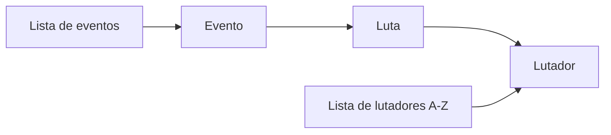
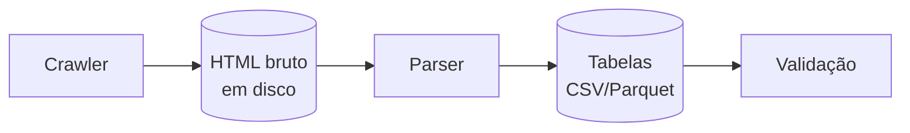
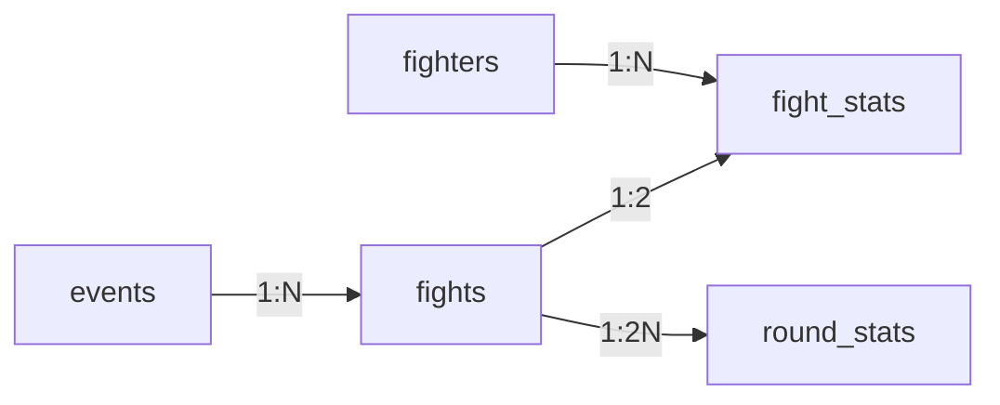

# Especificação — Scraper UFC Stats

Data: 2026-09-21

## 1. Contexto e objetivo

O scraper coleta o histórico completo do [UFC Stats](http://ufcstats.com/statistics/events/completed) (eventos, lutas, estatísticas e lutadores) para um trabalho de ciência de dados em grupo.

Hipótese inicial do trabalho: *a vantagem aparente do grappling se dissolve quando a amostra é restrita a lutas que foram à decisão.* Outras hipóteses podem surgir durante a análise.

Decisão central: **coletar tudo agora**. As hipóteses ainda não estão fechadas e o volume é pequeno (cerca de 700 eventos, 8 mil lutas e 4 mil lutadores). Recoletar depois custa mais do que coletar tudo de uma vez.

O scraper não faz análise. Ele entrega uma base limpa, relacional e reprodutível. Features analíticas, como médias pré-luta, são calculadas numa etapa posterior.

## 2. Escopo e estrutura do site

O site é HTML estático, sem login. Cada entidade tem um ID hexadecimal na URL, que será a chave primária.

> **Atualização 2026-09-21.** Na primeira visita de uma sessão o site devolve uma página intermediária ("Checking your browser…") com um desafio proof-of-work em JavaScript: `sha256(nonce:n)` até o hash começar com N zeros, `POST /__c` com `nonce` e `n`, e recarregar. O POST define o cookie `_fmc`, que libera as páginas seguintes. O cliente HTTP do scraper resolve esse desafio automaticamente na mesma sessão, com o mesmo rate limit e o mesmo User-Agent identificável — o conteúdo continua sendo HTML estático depois disso. Decisão do grupo em 2026-09-21.

| Página | URL | O que contém |
| --- | --- | --- |
| Lista de eventos | `/statistics/events/completed?page=all` | todos os eventos realizados: nome, data, local, link |
| Evento | `/event-details/<id>` | card completo: lutadores, vencedor, categoria, método, round, tempo, links das lutas |
| Luta | `/fight-details/<id>` | resumo (método, formato, árbitro, detalhes/placares) + estatísticas totais e por round |
| Lista de lutadores | `/statistics/fighters?char=<a-z>&page=all` | todos os lutadores por letra inicial |
| Lutador | `/fighter-details/<id>` | perfil, estatísticas de carreira, lista de lutas |

Fluxo de navegação:



Os lutadores são coletados pelas duas rotas: pelos links das lutas e pela lista A-Z. Isso garante que nenhum lutador fique de fora.

Fora do escopo: eventos futuros (`/upcoming`). Podem ser adicionados depois, mas não têm estatísticas.

## 3. Arquitetura

O scraper é dividido em duas etapas independentes: **coleta** (baixa e guarda o HTML bruto) e **parsing** (lê o HTML salvo e gera tabelas). O parsing nunca acessa o site.



Por que separar:

- Um bug no parser é corrigido reprocessando os arquivos locais, sem nova coleta.
- Campos novos podem ser extraídos depois, a partir do mesmo HTML.
- A base fica congelada numa data, o que garante reprodutibilidade.

Organização sugerida dos arquivos brutos:

```
data/raw/<data_coleta>/events_list.html
data/raw/<data_coleta>/events/<event_id>.html
data/raw/<data_coleta>/fights/<fight_id>.html
data/raw/<data_coleta>/fighters/<fighter_id>.html
data/raw/<data_coleta>/fighters_list/<letra>.html
```

Etapas de implementação, em ordem:

1. Crawler completo com cache (se o arquivo já existe, não baixa de novo).
2. Parser de eventos e resumo das lutas.
3. Parser das estatísticas totais e por round.
4. Parser de golpes significativos por alvo e posição.
5. Parser de lutadores.
6. Validação e exportação.
7. Modo incremental (só eventos novos).

Stack sugerida: Python, `requests` + `BeautifulSoup` (ou `lxml`), `pandas`. Scrapy é opcional; o volume não exige.

## 4. Modelo de dados

Cinco tabelas relacionais, ligadas pelos IDs do site. Nomes de colunas em `snake_case`, em inglês, para facilitar o código.



**`events`** — uma linha por evento

| Coluna | Tipo | Observação |
| --- | --- | --- |
| event_id | texto (PK) | ID da URL |
| name | texto | |
| date | data | |
| location | texto | cidade, estado, país |

**`fights`** — uma linha por luta

| Coluna | Tipo | Observação |
| --- | --- | --- |
| fight_id | texto (PK) | |
| event_id | texto (FK) | |
| fighter_a_id, fighter_b_id | texto (FK) | ordem da página (canto vermelho = A) |
| winner_id | texto, nulo | nulo em empate ou no contest |
| result_type | categórico | win, draw, no_contest |
| weight_class | categórico | |
| is_title_fight | booleano | |
| is_women | booleano | derivado da categoria |
| bonuses | lista | performance, luta da noite etc. |
| method | categórico | KO/TKO, SUB, U-DEC, S-DEC, M-DEC, DQ, overturned… |
| method_detail | texto | golpe ou finalização específica |
| went_to_decision | booleano | derivado de method |
| end_round | inteiro | |
| end_time_seconds | inteiro | tempo no round final |
| total_fight_seconds | inteiro | calculado |
| scheduled_rounds | inteiro | do formato, ex.: 3 ou 5 |
| time_format_raw | texto | valor original |
| referee | texto | |
| judges_scores | JSON | lista de {juiz, nota_a, nota_b}, só em decisões |
| details_raw | texto | valor original |

**`fight_stats`** — uma linha por lutador por luta (totais)

| Coluna | Tipo |
| --- | --- |
| fight_id, fighter_id | texto (PK composta) |
| kd | inteiro |
| sig_str_landed, sig_str_attempted | inteiro |
| total_str_landed, total_str_attempted | inteiro |
| td_landed, td_attempted | inteiro |
| sub_att | inteiro |
| rev | inteiro |
| ctrl_seconds | inteiro, nulo |
| head / body / leg _landed, _attempted | inteiro |
| distance / clinch / ground _landed, _attempted | inteiro |

**`round_stats`** — uma linha por lutador por round. Mesmas colunas de `fight_stats`, mais `round` (inteiro). PK: fight_id, fighter_id, round.

**`fighters`** — uma linha por lutador

| Coluna | Tipo | Observação |
| --- | --- | --- |
| fighter_id | texto (PK) | |
| name, nickname | texto | |
| height_cm, weight_kg, reach_cm | decimal, nulo | convertidos |
| stance | categórico, nulo | |
| dob | data, nulo | |
| wins, losses, draws, nc | inteiro | cartel na data da coleta |
| slpm, str_acc, sapm, str_def, td_avg, td_acc, td_def, sub_avg | decimal | carreira na data da coleta |

Toda tabela recebe também `scraped_at` (data da coleta) e `source_url`.

Formato de saída: CSV para facilitar a troca e Parquet (ou SQLite) para análise.

## 5. Regras de limpeza e normalização

O site entrega tudo como texto. A conversão segue estas regras, sempre guardando o valor original quando houver perda de informação.

| Valor no site | Conversão | Exemplo |
| --- | --- | --- |
| "X of Y" | duas colunas: landed = X, attempted = Y | "45 of 102" → 45, 102 |
| Percentuais ("44%") | descartar; recalcular a partir de landed/attempted | — |
| Tempo "m:ss" | segundos | "3:24" → 204 |
| Altura "5' 11"" | centímetros | 180,3 |
| Envergadura "72"" | centímetros | 182,9 |
| Peso "155 lbs." | quilos | 70,3 |
| Data "Mar. 15, 2025" | ISO `YYYY-MM-DD` | 2025-03-15 |
| "--" ou vazio | nulo, nunca zero | — |
| Formato "5 Rnd (5-5-5-5-5)" | scheduled_rounds = 5 | — |

Regras adicionais:

- **Nulo não é zero.** Um campo ausente em luta antiga é nulo. Zero significa que o evento aconteceu zero vezes.
- **Identidade por ID.** Existem homônimos; nomes nunca são usados como chave.
- **Texto limpo.** Remover espaços e quebras de linha extras; manter acentos e caracteres originais dos nomes.
- **Categorias padronizadas.** Mapear os valores de `method` e `weight_class` para um conjunto fixo, e registrar valores não mapeados em log em vez de descartá-los.
- **Placares dos juízes.** Extrair do campo de detalhes das decisões; se o padrão não bater, manter só o texto original.

## 6. Requisitos não funcionais

| Requisito | Regra |
| --- | --- |
| Taxa de requisições | 1 requisição por vez, intervalo de 1 a 2 s entre elas |
| User-Agent | identificável, com contato do grupo |
| Tentativas | até 3, com espera crescente (ex.: 5 s, 15 s, 45 s) |
| Timeout | 30 s por requisição |
| Retomada | se interrompido, continua de onde parou usando o cache em disco |
| Logs | URL, status, tempo e erros de parsing, em arquivo |
| Incremental | compara IDs de eventos já salvos e baixa só os novos (e os lutadores envolvidos) |
| Reprodutibilidade | cada coleta vai para uma pasta com a data; a análise usa uma coleta fixa |
| Configuração | intervalo, pasta de saída e modo (completo/incremental) em arquivo ou argumentos de linha de comando |

Antes da primeira execução, ler o `robots.txt` e os termos do site. (`robots.txt` verificado em 2026-09-21: não existe — HTTP 404.)

A carga completa leva algumas horas (cerca de 13 mil páginas). Deve rodar sem supervisão.

## 7. Validação e critérios de aceite

O scraper é considerado pronto quando todos os itens abaixo passam automaticamente.

**Integridade**

- [ ] Todo evento da lista tem arquivo HTML e linha em `events`.
- [ ] Toda luta de todo evento está em `fights`.
- [ ] Todo `fighter_id` citado em `fights` existe em `fighters`.
- [ ] Nenhuma chave primária duplicada.

**Consistência**

- [ ] landed ≤ attempted em todos os pares.
- [ ] Golpes significativos ≤ golpes totais.
- [ ] head + body + leg = sig_str (landed e attempted); o mesmo para distance + clinch + ground.
- [ ] Soma dos rounds em `round_stats` = totais em `fight_stats`, quando os rounds existem.
- [ ] end_round ≤ scheduled_rounds; tempo de controle ≤ duração da luta.
- [ ] winner_id é um dos dois lutadores ou nulo.

**Cobertura (relatório, não bloqueia)**

- [ ] Percentual de nulos por coluna e por ano, para identificar a partir de quando cada campo (ex.: tempo de controle, rounds) está preenchido de forma confiável.
- [ ] Contagem de lutas por método e por ano.

**Conferência manual**

- [ ] Comparar 10 lutas sorteadas (de épocas diferentes) com o site, campo a campo.

## 8. Decisões, fora de escopo e questões em aberto

Esta seção serve de contexto para quem implementar, incluindo assistentes de IA. As decisões abaixo já foram tomadas e não devem ser revertidas sem conversa no grupo.

| Decisão | Motivo |
| --- | --- |
| Coletar todos os dados, não só os da hipótese | hipóteses ainda abertas; volume pequeno; recoletar custa mais |
| Coleta (HTML bruto) separada do parsing | corrigir bugs e extrair campos novos sem acessar o site de novo |
| IDs do site como chaves | existem lutadores homônimos |
| Nulo ≠ zero | lutas antigas não têm estatísticas; zero seria falso |
| Estatísticas de carreira do perfil são só referência | são um retrato da data da coleta e incluem lutas futuras; usar na análise causaria vazamento de dados |
| Guardar `scraped_at` e coletas datadas | reprodutibilidade científica |
| Manter a ordem A/B da página, sem sortear | o sorteio do canto é decisão da análise, não do scraper |

**Fora do escopo do scraper**

- Cálculo de médias pré-luta e outras features analíticas.
- Sorteio da ordem dos lutadores e filtros de amostra.
- Eventos futuros, odds de apostas e dados de outras fontes.

**Questões em aberto**

- [x] ~~A partir de que ano o tempo de controle e as estatísticas por round são confiáveis?~~
  **Respondido pela coleta de 2026-09-21** (`data/processed/<date>/coverage_report.md`),
  usando o critério "≥ 95 % das lutas do ano, sem regressão nos anos seguintes":

  | campo | confiável a partir de | observação |
  | --- | --- | --- |
  | estatísticas por round (`round_stats`) | **1999** | antes disso, 84–95 % conforme o ano |
  | golpes significativos por alvo/posição | **1999** | mesma cobertura de `round_stats` |
  | tempo de controle (`ctrl_seconds`) | **2000** | 0 % até 1998, 50 % em 1999, 100 % desde 2000 |
  | placares dos juízes (em decisões) | **2003** | 0 % até 2000, 75 % em 2001, 80 % em 2002 |

  Para a hipótese do grappling, que depende de `ctrl_seconds` e quedas, o recorte
  seguro é **2000 em diante** (8 673 das 8 897 lutas, 97,5 %). Se a análise usar
  placares de juízes, o recorte é 2003.

- [x] ~~Formato final: Parquet ou SQLite?~~ **Ambos são gerados** (`export --format parquet|sqlite`),
  com os mesmos tipos explícitos. Parquet para carregar em pandas; SQLite quando for
  útil consultar com SQL. Não foi preciso escolher.
- [ ] Como tratar lutas com resultado anulado (overturned) na análise? (o scraper marca
  `result_type = no_contest` e preserva `method = OVERTURNED`, `details_raw` e os placares
  originais; a decisão de incluir ou excluir é da análise)
- [ ] Divisão de tarefas entre os dois implementadores.
